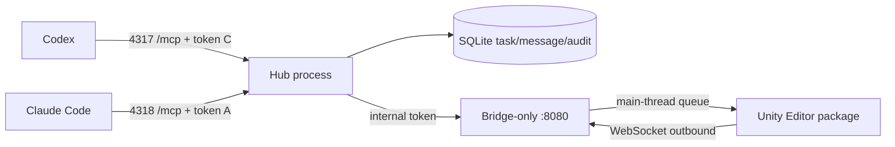

# Multi-Agent MCP Hub — kiến trúc triển khai

**Trạng thái:** vertical slice đang triển khai, 2026-10-15. Nguồn yêu cầu là bản implementation plan người dùng cung cấp; tài liệu này ghi quyết định kỹ thuật của repo.

## Cấu trúc hiện tại

Hub mở ba listener trên `127.0.0.1`. Hai endpoint agent dùng FastMCP riêng và token riêng. Cổng bridge giữ route `/hub/plugin` cho Unity; `/api/instances` và `/api/command` chỉ nhận token nội bộ sinh khi Hub khởi động. `/mcp` trên cổng bridge bị đóng. Token agent không được dùng để gọi REST bridge. Unity package tiếp tục dùng `WebSocketTransportClient` và `TransportCommandDispatcher` sẵn có, nên lệnh Unity vẫn vào hàng đợi main thread.

Các Unity tool được expose ở lát cắt đầu chỉ có `hub.health`, `hub.project.info`, `unity.scenes.list`. `unity.scenes.list` gọi duy nhất `manage_scene` với action `get_loaded_scenes`. Nếu có nhiều Editor, tool yêu cầu `unity_instance` rõ ràng. Cấu hình Codex và Claude phải trỏ cổng Hub riêng, không trỏ cổng bridge.

`hub.task.*` và `hub.message.*` dùng chung SQLite giữa hai endpoint. Task đi qua `queued → running → completed` hoặc `cancelled`; chỉ assignee được claim/complete, creator hoặc assignee được cancel. Message ở inbox cho đến khi recipient ack. Create/send cần idempotency key; việc gửi lại cùng key và nội dung trả cùng record. Audit lưu metadata của các mutation task/message, không lưu token. Ở chế độ client tự kết nối, agent phải chủ động gọi inbox để nhận việc; Hub chưa khởi chạy CLI.

## Ranh giới tin cậy

- `agentId` đến từ endpoint đã xác thực, không nhận từ tham số tool.
- Hub kiểm tra `Host`, `Origin` và bearer token trước MCP handler. Cổng bridge kiểm tra `Host`, `Origin` và token riêng cho REST.
- Mọi listener chỉ bind loopback. Token không xuất hiện trong log và không được ghi vào repo.
- Chưa có tool ghi hoặc tool phá hủy trong endpoint Hub. Khi thêm mutation, cần lock lease, approval và xác minh ngay trước khi dispatcher thực thi.
- WebSocket Unity hiện là đường local chưa có handshake secret riêng. Đây là việc cần xử lý trước khi coi Hub là ranh giới bảo mật hoàn chỉnh.

## Các phase tiếp theo

1. Xác minh Codex CLI và Claude Code CLI thật trên hai endpoint, cùng Unity Editor đang mở.
2. Thêm project identity bền và structured audit cho mọi call.
3. Thêm timeout/recovery, review state và CLI adapter để Hub có thể chủ động chạy workflow worker–reviewer.
4. Thêm lock và policy metadata cho Unity tools trước khi phơi bày mutation.
5. Mở rộng EditorWindow trạng thái hiện có thành onboarding, generator cấu hình và diagnostics.

MCP 2025 và 2026 có handshake khác nhau; phiên bản protocol hỗ trợ chỉ được công bố sau khi thử hai client thực tế. Tham khảo [OpenAI Docs](https://learn.chatgpt.com/docs/extend/mcp?surface=cli), [Claude Code MCP docs](https://code.claude.com/docs/en/mcp) và [MCP SDK protocol versions](https://ts.sdk.modelcontextprotocol.io/v2/protocol-versions).
